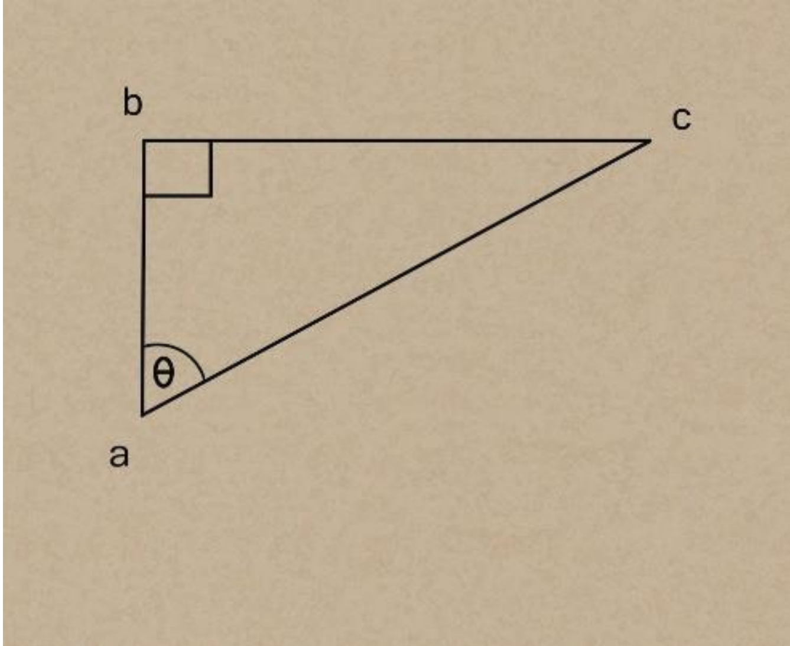
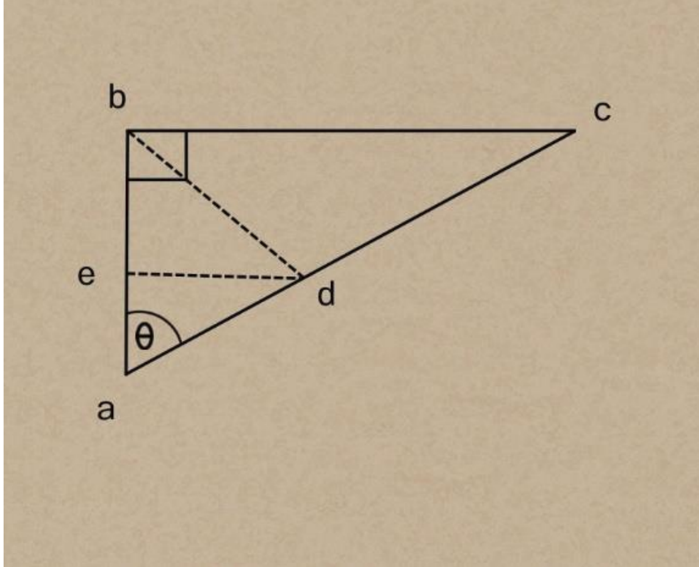
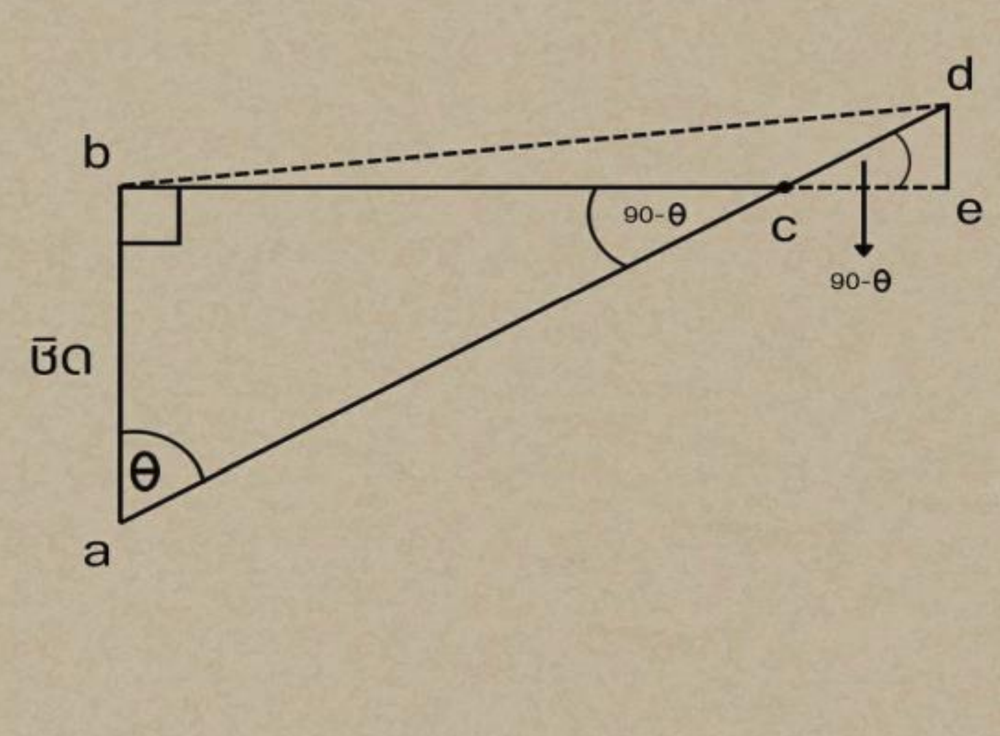

# Speed Radar — เรดาร์วัดความเร็ววัตถุด้วยตรีโกณมิติ

วัดระยะทางและความเร็วของวัตถุที่เคลื่อนที่ด้วยเซ็นเซอร์อัลตราโซนิกและเซอร์โวมอเตอร์ โดยคำนวณด้วยฟังก์ชันตรีโกณมิติและทฤษฎีบทพีทาโกรัส บน Raspberry Pi Pico (MicroPython)

## วิธีการทำงาน

1. เซอร์โวหมุนเซ็นเซอร์ไปที่มุม **58°** แล้ววัดระยะห่างจากวัตถุ
2. ถ้าระยะ ≤ **50 cm** เริ่มจับเวลา แล้วหมุนเซอร์โวไปที่มุม **122°** (ทำมุม 64° กับตำแหน่งแรก)
3. วัดระยะทางอีกครั้งจนตรวจพบวัตถุ แล้วหยุดเวลา
4. คำนวณระยะทางที่วัตถุเคลื่อนที่จริงตามกรณีการเคลื่อนที่
5. แปลงระยะทางเป็นเมตร หารด้วยเวลา (วินาที) จะได้ความเร็ว

```python
speed = (distance / 100) / time   # m/s
```

## สูตรที่ใช้

**กรณีที่ 1 — วัตถุเคลื่อนที่ตั้งฉากกับระยะเรดาร์–จุดเริ่มต้น**



```
tan θ = bc / ab
bc = tan θ × ab
```

**กรณีที่ 2 — วัตถุเคลื่อนที่เข้าหาเรดาร์**



ลากเส้นจากจุดวัตถุตั้งฉากกับเส้นเรดาร์–จุดเริ่มต้น จะได้สามเหลี่ยมมุมฉากเพิ่ม

```
sin θ = de / ad   →   de = sin θ × ad
ae = √(ad² - de²)
be = ab - ae
bd = √(de² + be²)
```

**กรณีที่ 3 — วัตถุเคลื่อนที่ออกจากเรดาร์**



```
bc = tan θ × ab
ac = √(ab² + bc²)
cd = ad - ac
de = sin(90° - θ) × cd
ce = √(cd² - de²)
bd = √(de² + (bc + ce)²)
```

## อุปกรณ์

- Raspberry Pi Pico (RP2040)
- เซ็นเซอร์อัลตราโซนิก HC-SR04
- เซอร์โวมอเตอร์
- จอ OLED SSD1306 128×64 (เวอร์ชัน Arduino)

## การต่อขา

| อุปกรณ์ | Raspberry Pi Pico | Arduino |
|---|---|---|
| Trig | GP7 | D5 |
| Echo | GP9 | D6 |
| Servo | GP20 | D3 |

## การใช้งาน

**MicroPython (Raspberry Pi Pico)**

1. ติดตั้ง MicroPython firmware ลงบนบอร์ด
2. อัปโหลด `main.py` ด้วย Thonny IDE
3. รันโปรแกรมและดูผลทาง Serial Monitor

**Arduino (OLED)**

1. ติดตั้งไลบรารี `Adafruit GFX`, `Adafruit SSD1306`, `Servo`, `Wire`
2. อัปโหลด `speed_rada.ino`
3. เปิด Serial Monitor ที่ 115200 baud

## ไฟล์ในโปรเจกต์

| ไฟล์ | รายละเอียด |
|---|---|
| `main.py` | โปรแกรมหลักสำหรับ Raspberry Pi Pico (MicroPython) |
| `speed_rada.ino` | เวอร์ชัน Arduino พร้อมแสดงผลบน OLED |
| `Senser.py` | ทดสอบการอ่านค่าระยะทาง |
| `Servo.py` | ทดสอบการควบคุมเซอร์โว |
| `Time.py` | ทดสอบการจับเวลา |
| `math.py` | ทดสอบฟังก์ชันตรีโกณมิติ |
